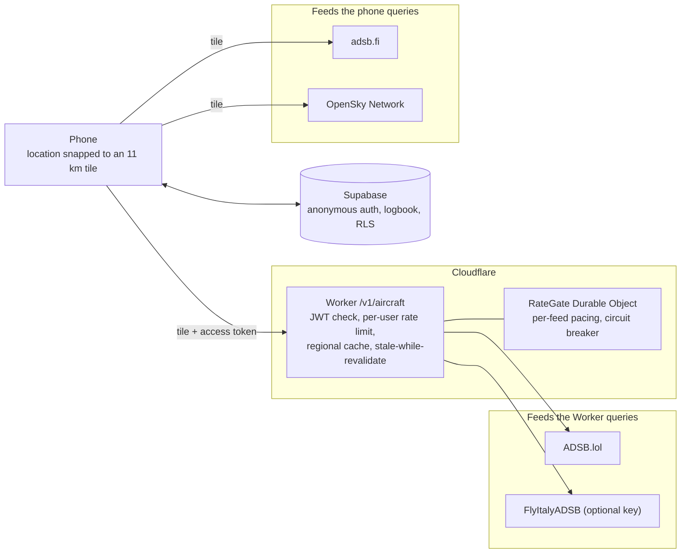

# Flight View

Point your phone at a plane and see what it is.

Flight View shows the live camera feed with a small label over every aircraft in view: callsign, altitude and distance. Tap one for the airline, aircraft type, registration, speed and heading, and save it to your logbook. It runs natively on iOS (SwiftUI) and Android (Kotlin and Jetpack Compose), with a Cloudflare Worker and Supabase behind it.

There are no paid data services. Aircraft positions come from the raw ADS-B and MLAT signals picked up by thousands of volunteer receivers around the world. The Worker and the phone each query the free feeds they can reach (some networks block cloud servers but serve phones), and the results are merged by aircraft so coverage is as wide as possible.

## How it works



Some networks block cloud servers but serve phones, so the work is split: the Worker queries the
feeds that accept it and caches by region, while each phone also asks adsb.fi and OpenSky directly.
Everything is merged by ICAO address. The freshest position wins and missing fields are filled in
from the other reports.

Every frame, each phone:

1. Advances every aircraft from its last reported position to the current moment along a great circle, using its ground speed, track and climb rate. Feeds lag a few seconds and the phone only polls every 2 s, so without this labels would trail the planes.
2. Converts aircraft and observer positions to Earth-centred coordinates (WGS84), then to a local east-north-up frame, which gives azimuth, elevation and slant range. Earth curvature is handled exactly.
3. Rotates that direction into the camera frame using the device attitude, corrected to true north, and projects it with a pinhole camera model whose focal length is derived from the real lens field of view and the preview's aspect-fill crop.
4. Smooths the result, declutters overlapping labels, and draws arrows at the screen edge for nearby aircraft that are out of view.

The full derivation is in [docs/MATHS.md](docs/MATHS.md).

## Repository layout

| Path | What it is |
| --- | --- |
| `shared/reference/` | Python reference implementation of all the geometry, tested against [pymap3d](https://github.com/geospace-code/pymap3d). The single source of truth. |
| `shared/fixtures/` | Golden test cases generated from the reference. iOS, Android and CI all test against this one file. |
| `backend/worker/` | Cloudflare Worker that fans out to the free feeds, merges, caches and rate-limits. |
| `backend/supabase/` | Database migration (profiles, logbook, RLS) and local config. |
| `ios/` | SwiftUI app plus `FlightViewCore`, a dependency-free Swift package with the maths. |
| `android/` | Compose app plus `:core`, a plain JVM module with the same maths. |

## Running it

### 1. Supabase

Create a project, enable **Anonymous sign-ins** (Authentication > Providers), and make sure the project uses **asymmetric JWT signing keys** (Settings > JWT Keys). The Worker verifies tokens against the project's public JWKS, so it never needs a secret. Then:

```bash
cd backend/supabase
supabase link --project-ref YOUR-PROJECT-REF
supabase db push
```

### 2. Worker

```bash
cd backend/worker
npm ci
# edit wrangler.toml: SUPABASE_URL and a real contact URL in USER_AGENT
npx wrangler secret put FLYITALY_API_KEY        # optional, free key from flyitalyadsb.com
npx wrangler secret put OPENSKY_CLIENT_ID       # optional, free OpenSky account
npx wrangler secret put OPENSKY_CLIENT_SECRET
npm run deploy
```

Feeds without credentials are skipped automatically. Deploys also run automatically from `main` through Cloudflare Workers Builds.

### 3. iOS

```bash
brew install xcodegen
cd ios
cp Config/Secrets.example.xcconfig Config/Secrets.xcconfig   # fill in the three values
xcodegen
open FlightView.xcodeproj
```

Run on a real device: the simulator has no camera or compass.

### 4. Android

```bash
cd android
cp secrets.example.properties secrets.properties   # fill in the three values
./gradlew :app:installDebug
```

## Tests

```bash
(cd shared/reference && python -m pytest -q)          # reference vs pymap3d, 10 tests
(cd backend/worker && npm test)                        # parsing, merging, privacy tiling, fan-out
(cd ios/Packages/FlightViewCore && swift test)         # Swift core vs golden fixtures + scene tests
(cd android && ./gradlew :core:test :app:testDebugUnitTest)
```

CI runs all four on every push (`.github/workflows/ci.yml`), and fails if the fixtures drift from the reference.

## Data sources and licensing

See [docs/DATA_SOURCES.md](docs/DATA_SOURCES.md). In short: ADSB.lol (ODbL) and FlyItalyADSB (CC BY-SA) allow commercial use with attribution. airplanes.live, adsb.fi, ADSB One and OpenSky are free for non-commercial use. Setting `COMMERCIAL_MODE = "true"` in `wrangler.toml` drops the non-commercial feeds in one line. Attribution for whichever feeds answered is returned with every response and shown in the app.

## Security

- No secrets live in the repository. The Android upload key is a GitHub Actions secret (`ANDROID_SIGNING`), Worker keys are Cloudflare secrets, and local builds read `android/secrets.properties` and `ios/Config/Secrets.xcconfig`, both git-ignored with committed `.example` templates.
- The only Supabase key in the apps is the publishable key, which is designed to ship in clients. Every table has Row Level Security, so it grants nothing beyond the signed-in user's own rows.
- The Worker verifies Supabase access tokens against the project's public JWKS (asymmetric ES256 keys), rate-limits per user, and never logs coordinates.
- Google Play App Signing holds the app signing key; the upload key used by CI can be reset if it is ever exposed.
- Dependabot keeps dependencies current. See [SECURITY.md](SECURITY.md) to report a vulnerability.

## Privacy

- The camera feed never leaves the phone.
- Before any request is made, the phone snaps its location to the centre of a 0.1 degree grid tile (about 11 km). The Worker snaps it again, and never logs coordinates. The two feeds the phone queries directly (adsb.fi and OpenSky) receive the same coarse tile and can see the IP address of the phone.
- Accounts are anonymous Supabase users. The logbook stores the tile, not the position. Row Level Security limits every query to the owner.
- No analytics, no tracking, no third-party SDKs beyond Supabase. The iOS privacy manifest declares exactly this.

## Accessibility

The AR view is inherently visual, so the app also offers a list of every aircraft in range, nearest first, with clock-face directions relative to where the phone is pointing ("2 o'clock, 24 km, 21 degrees up"). It works fully with VoiceOver and TalkBack. Dynamic Type is respected on iOS, and Reduce Motion lowers the overlay frame rate.
